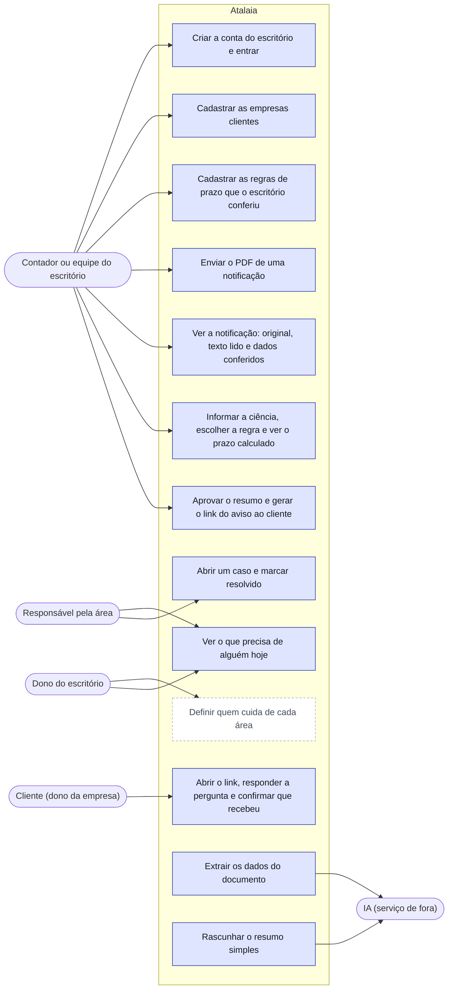
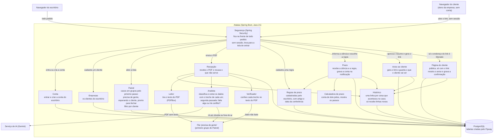
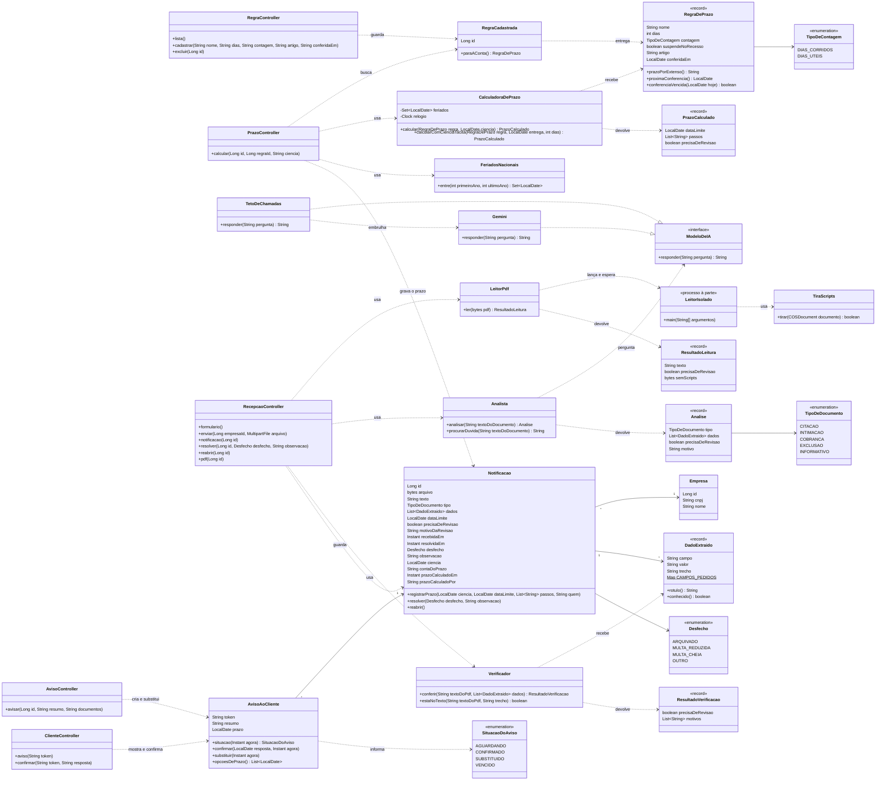
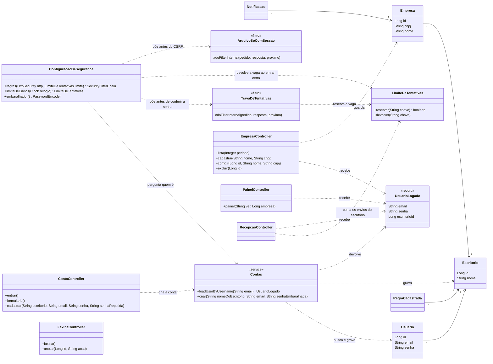
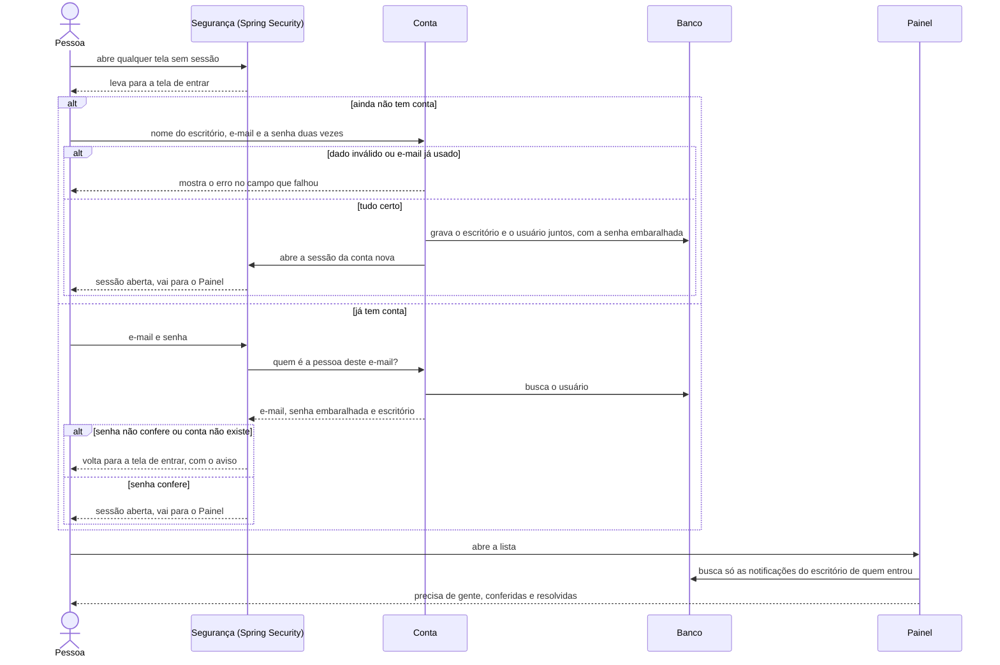
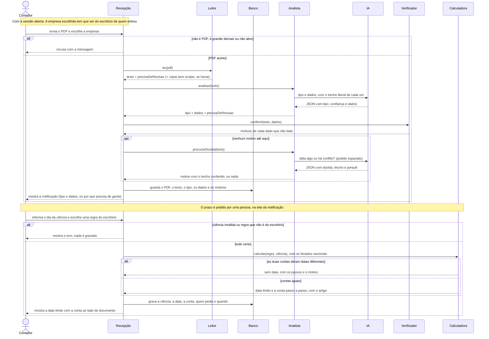
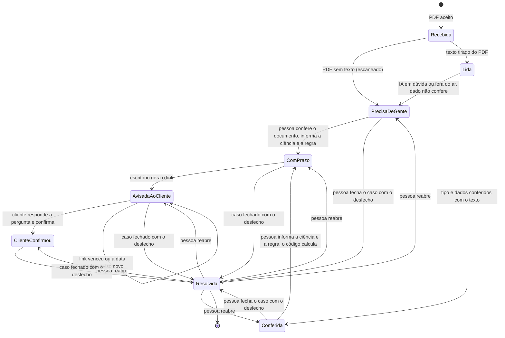
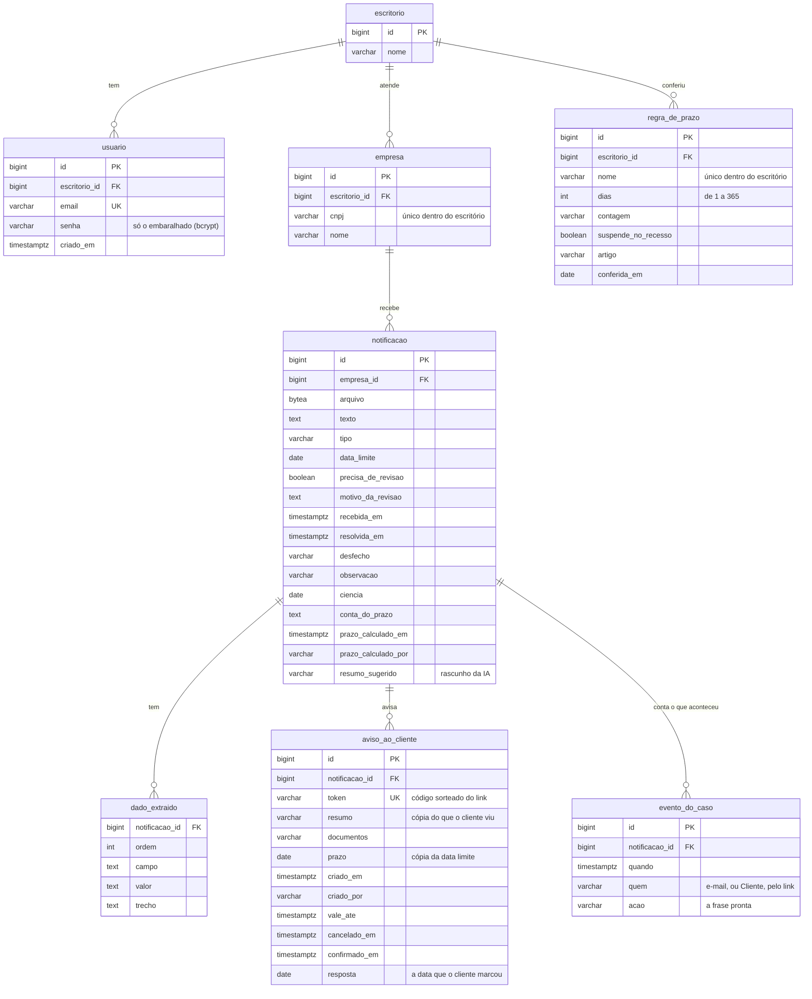

# Arquitetura e diagramas · Atalaia (19/11/2026, já com o login, o prazo na tela, o aviso ao cliente e o histórico do caso)

Como o Atalaia é montado por dentro e como as peças conversam. Os desenhos são feitos em Mermaid, que o GitHub desenha sozinho.

Em cada diagrama separei o que **já existe no código** do que está **planejado**. Planejado aparece tracejado ou com a marca "(planejado)".

## A ideia em uma frase

O PDF passa por uma fila de peças pequenas. Cada peça faz uma coisa só e sabe dizer "precisa de gente". A IA participa de uma peça só (o Analista), com três tarefas: separar os dados, rascunhar o resumo e, numa segunda pergunta, dizer se falta algo ou há conflito no documento. Ela nunca calcula prazo.

## 1. Casos de uso

Quem usa o Atalaia e para quê. A IA aparece como ator, porque é um serviço de fora que o sistema chama.



Azul: já dá para fazer. Tracejado: planejado.

Hoje toda pessoa que entra pode o mesmo, dentro do próprio escritório. Os papéis (responsável pela área, dono) entram junto com "definir quem cuida de cada área".

## 2. Arquitetura: as peças e quem chama quem

Um sistema só (monólito) em Spring Boot. As telas são páginas HTML montadas no servidor (Thymeleaf), sem aplicativo separado.



Todas as ligações do desenho já funcionam. Aviso por e-mail e por Telegram fica para depois de 03/12: hoje o escritório copia o link e manda pelo canal que já usa com o cliente.

Decisões:

- **A IA nunca calcula prazo.** O prazo sai da Calculadora, que é só `java.time`.
- **Nenhuma regra de prazo vem no código.** Cada escritório cadastra as regras que ele mesmo leu na norma, com o artigo e a data da conferência (RNF09). Seis meses depois, a regra aparece como vencida, pedindo nova conferência.
- **O prazo nasce de uma pessoa.** Ela informa o dia da ciência e escolhe a regra; a Calculadora faz a conta de dois jeitos e a notificação guarda a data com a conta inteira, o artigo, quem pediu e quando. A conta é uma cópia: excluir a regra depois não muda o que foi mostrado. Se as duas contas não baterem, a notificação fica sem data e mostra o motivo.
- **Feriados: só os nacionais de data fixa.** Toda conta avisa que feriado estadual, municipal, ponto facultativo e Sexta-feira Santa não entram, para a pessoa conferir.
- **O aviso ao cliente é um link sem senha.** O endereço leva um código sorteado de 32 bytes, vale 30 dias e mostra só aquele aviso. O aviso guarda uma cópia do resumo, dos documentos e da data limite: é a prova do que o cliente viu. Um aviso novo tira a validade do anterior, mas nunca apaga uma confirmação já feita.
- **A confirmação tem uma pergunta de conferência.** O código monta três datas, uma delas a data limite, e o cliente marca uma. Errar não impede confirmar: a página explica a data certa e o escritório fica sabendo que vale uma ligação. A confirmação se chama "registro de ciência" e prova que o link foi aberto e confirmado, não quem é a pessoa.
- **O resumo da IA é rascunho.** Ele vem no mesmo pedido em que o Analista classifica o documento e abre o campo do aviso. O código joga fora o rascunho que cite data, dias, mês ou link, ou que traga um número que não esteja escrito igual no documento. Quem aprova e envia é o escritório.
- **Um relógio só.** Todo controller pede ao Spring o mesmo relógio, no fuso de Teresina, em vez de olhar a hora do servidor.
- **Toda peça devolve um aviso `precisaDeRevisao`.** É o mesmo desenho no Leitor, no Verificador e na Calculadora. Se uma falhar, o caso fica sem prazo e vai para uma pessoa (RNF01).
- **Os clientes do escritório num painel só (US18 e US62).** A tela inicial tem a escolha do cliente quando o escritório atende duas empresas ou mais; cada opção diz quantos casos abertos o cliente tem, e escolher um deixa só os casos dele (`/?empresa=id`, formulário GET sem JavaScript). Número de empresa de outro escritório no endereço é ignorado. A tela de empresas mostra quantos casos cada cliente teve nos últimos 30 dias, 90 dias ou 12 meses (`NotificacaoRepository.contarPorEmpresa`, que devolve `CasosDaEmpresa`), para o escritório rever a cobrança de quem dá mais trabalho.
- **Faxina da semana (US32).** A tela `/faxina` (`FaxinaController`) lista os casos abertos sem nenhum evento no histórico há mais de 7 dias (`NotificacaoRepository.parados`, que devolve `CasoParado`; caso sem evento conta a data de chegada), com o vencido primeiro. "Resolvido" leva ao cartão "Fechar o caso", porque fechar pede desfecho e observação; "Segue aberto" e "Adiar uma semana" gravam um evento no histórico, e esse evento tira o caso da faxina por mais 7 dias.
- **Trilha encadeada (US27).** Cada evento do histórico grava uma assinatura SHA-256 dos dados dele (caso, instante em milissegundos, quem, frase) junto com a assinatura do evento anterior do mesmo caso (`EventoDoCaso.assinar`). Para dois eventos simultâneos não abrirem duas correntes, o `Historico.registrar` tranca a linha do caso antes de ler a última assinatura. `Trilha.conferir` refaz as assinaturas na ordem de gravação: um registro alterado, apagado ou sem assinatura depois do primeiro assinado aparece na tela do caso, a partir de qual registro. O PDF da trilha (`TrilhaController`, `/notificacoes/{id}/trilha`) traz cada assinatura e o selo (a assinatura do último registro). A corrente sozinha não impede quem tem acesso ao banco de refazer todas as assinaturas: quem guardou o PDF guardou o selo, e o selo novo não bate com o antigo. Duas regras que saem disso: dado do histórico não se corrige por migração (reescrever uma frase acusaria adulteração em todos os casos), e quem tranca o caso o faz antes de qualquer outra linha (`Historico.trancar`; a confirmação do cliente tranca o caso e depois o aviso, na mesma ordem do escritório, para não dar deadlock no Postgres).
- **O escritório é a cerca dos dados.** Cada usuário e cada empresa pertencem a um escritório. Toda busca de empresa ou de notificação leva o `escritorioId` de quem entrou, e a notificação de outro escritório responde como se não existisse (404). O `IsolamentoEntreEscritoriosTest` tenta furar essa cerca de quatro jeitos. Os repositórios estendem `Repository` (e não `JpaRepository`): não existe `findAll` nem `findById` sem o escritório, e um teste confere que todo método de repositório recebe o `escritorioId` ou está numa lista curta de exceções com motivo (gravar, entrar pelo e-mail, a página do cliente pelo token).
- **Empresa com caso não é excluída.** Nome e CNPJ podem ser corrigidos a qualquer momento; excluir só vale para empresa sem nenhum caso, numa operação só no banco (`excluirSemCasos`). Os casos são o histórico do escritório e a prova do que o cliente confirmou.
- **A pessoa se cadastra sozinha.** O cadastro grava o escritório e a primeira pessoa dele juntos (ou os dois, ou nenhum) e a conta já nasce com a sessão aberta. Ainda não há papéis nem convite de colegas.
- **A senha nunca é guardada.** Só o embaralhado dela (bcrypt). Quem confere e-mail e senha é o Spring Security; a sessão anda só pelo cookie, todo formulário leva o código contra pedido forjado (CSRF) e sair é por POST.
- **Toda resposta sai com cabeçalhos de segurança** (filtro `CabecalhosDeSeguranca`): a página só carrega o que é do próprio Atalaia e não pode ser mostrada dentro de outro site.
- **Tentar adivinhar senha trava** (filtro `TravaDeTentativas`, conta no `LimiteDeTentativas`): 10 senhas erradas ou 10 cadastros por endereço a cada 15 minutos. A vaga é reservada antes de conferir a senha, numa operação só (uma rajada não passa), e entrar certo devolve a vaga. A conta fica na memória do servidor.
- **Envio de arquivo só de quem entrou** (filtro `ArquivoSoComSessao`, antes do CSRF): quem não entrou vai para `/entrar?expirou` sem o servidor ler o arquivo. Sem ele, o filtro do CSRF leria até 16 MB procurando o código do formulário.
- **A IA tem teto** (issue #144): no máximo 60 envios por escritório a cada 15 minutos (a mesma peça `LimiteDeTentativas`, com o escritório como chave; passou disso, 429) e no máximo 5 análises ao mesmo tempo (`TetoDeChamadas` em volta do Gemini; sem vaga em 10 s, o caso vai para uma pessoa). Limite conhecido: quem cria várias contas soma as cotas.
- **O PDF é lido num processo à parte** (`LeitorIsolado`, lançado pelo `LeitorPdf`; issue #144). O PDF vem de fora e pode ser montado para inchar: um arquivo de 1 MB virava 1 GB ao abrir e derrubava a memória, e o PDFBox abre cada parte inteira antes de deixar alguém contar. Então o PDFBox roda num `java` com 256 MB e 20 s, no máximo 2 leituras ao mesmo tempo. Se ele morrer (memória, tempo, defeito), morre só ele e o envio é recusado. Dentro dele: 100 páginas e 300 mil letras no máximo. No ar o servidor precisa de memória para o Atalaia mais 2 × 256 MB.
- **O PDF original fica do jeito que chegou; a tela pode mostrar uma cópia.** A notificação pode vir assinada, e regravar quebraria a assinatura. Quando o PDF traz algo que age sozinho (script, abrir programa, arquivo da rede), o `TiraScripts` faz uma cópia que só mantém "ir para página" e links `http`, `https` e `mailto`, e é ela que a moldura mostra (V12).
- **O banco é criado pelo Flyway**, por arquivos SQL numerados. O Hibernate só confere se as classes batem com as tabelas.
- **Segunda passada: "falta algo ou há conflito?" (US25).** Quando a leitura passou em tudo (nenhum motivo de revisão), a Recepção faz uma segunda pergunta à IA, num pedido separado (`Analista.PEDIDO_DA_DUVIDA`): o documento tem prazo ou valor escrito de dois jeitos que não batem, prazo em branco, anexo que falta, datas que se contradizem? Com dúvida, o caso vai para a fila "precisa de gente" sem prazo, e o motivo traz o porquê e o trecho que causou a dúvida. O trecho só aparece se estiver mesmo no texto do PDF (`Verificador.estaNoTexto`, a mesma regra dos dados); trecho inventado não apaga a dúvida. Resposta fora do formato, sem o `duvida` ou IA fora do ar contam como dúvida. Caso que já foi para revisão não faz a segunda pergunta (a pessoa vai olhar o documento de qualquer jeito). Medido com o Gemini em 19/11 (`SegundaPassadaComIATest`): das 10 notificações, as 3 adulteradas seguras e as 7 em ordem sem revisão.
- **A Recepção rege o caminho.** Ela chama o Leitor, o Analista e o Verificador, um depois do outro, e junta os motivos de revisão. Com um motivo que seja, a notificação vai para uma pessoa.
- **A IA fica atrás de uma interface** (`ModeloDeIA`). Hoje quem responde é o Gemini; os testes usam uma IA de mentira, sem internet. Sem a chave `GEMINI_API_KEY`, o sistema sobe igual e manda tudo para revisão.
- **O que a IA diz é conferido por código.** Cada dado precisa aparecer no texto do PDF (Verificador), e um "informativo" que fala em prazo, intimação, citação ou multa vai para revisão. O nome do dado também é conferido: só valem os seis campos do pedido (`DadoExtraido.CAMPOS_PEDIDOS`; um teste garante que o pedido à IA lista os mesmos). Um valor certo com nome inventado iria para a tela como conferido, então vai para revisão.
- **Peças conversando por eventos** (uma publica "documento lido", a outra escuta): fica para quando a análise sair do pedido da tela. Hoje a pessoa espera a resposta da IA com a tela aberta.

## 3. Classes

O que está no código hoje (o `PainelController` e os controllers da conta estão no 3.2). Os pacotes são `leitor`, `analista`, `verificador`, `prazo`, `notificacao`, `recepcao`, `painel`, `aviso`, `historico`, `conta` e `seguranca`: cada peça mora no pacote com o nome dela.

São dois desenhos, para caber na tela: primeiro o caminho do PDF, depois a conta e a cerca do escritório.

### 3.1 O caminho do PDF



### 3.2 A conta e a cerca do escritório



`Usuario.senha` guarda só o embaralhado (bcrypt). O `UsuarioLogado` é o que o Spring Security mantém enquanto a sessão está aberta: os três controllers recebem esse objeto e usam o `escritorioId` dele em toda busca. A notificação não tem escritório próprio: chega nele pela empresa.

Quando o arquivo passa da trava do servidor (15 MB), o pedido é barrado antes do controller e a pessoa vê a página de erro (`error.html`) com a mensagem do limite.

## 4. Sequências

### 4.1 Criar a conta e entrar



Escritório novo ainda não tem empresa: o Painel aponta para a tela Empresas, que é o primeiro passo antes de enviar um PDF.

### 4.2 Do PDF enviado até o prazo

No desenho, "Recepção" é a tela da notificação: o pedido do prazo é atendido pelo `PrazoController`.



### 4.3 Do aviso até o registro de ciência

```mermaid
sequenceDiagram
    actor Contador
    participant Aviso as Aviso (com sessão)
    participant Banco
    participant Pagina as Página do cliente (sem sessão)
    actor Cliente

    Note over Contador,Aviso: Só com o caso aberto e a data limite calculada
    Contador->>Aviso: aprova ou corrige o resumo, lista os documentos
    Aviso->>Banco: tranca os avisos do caso e tira a validade do anterior
    Aviso->>Banco: grava o aviso novo: código sorteado, resumo, documentos e a data limite
    Aviso-->>Contador: mostra o link para copiar
    Contador-->>Cliente: manda o link pelo canal que já usa

    Cliente->>Pagina: abre o link
    Pagina->>Banco: busca o aviso pelo código
    alt código que não existe
        Pagina-->>Cliente: página de erro, sem dizer nada do caso
    else aviso substituído ou vencido
        Pagina-->>Cliente: pede um link novo ao escritório, sem mostrar o conteúdo
    else aviso aguardando
        Pagina-->>Cliente: resumo, data limite, documentos e a pergunta com três datas
        Cliente->>Pagina: marca uma data e confirma
        Pagina->>Banco: tranca o aviso e grava o registro de ciência (quando e qual data marcou)
        Pagina-->>Cliente: confirma; se marcou a data errada, explica a certa
    end
    Note over Contador,Banco: A tela do caso e a lista inicial mostram: aguardando, confirmou, data errada ou link vencido
```

## 5. Estados da notificação



O código já percorre todos os estados do desenho.

Reabrir apaga o desfecho, a observação e `resolvidaEm` da notificação, mas antes grava tudo no histórico ("Reabriu o caso. Desfecho anterior: … Observação: …"). Nada do que foi registrado se perde, e o caso pode ser fechado de novo. O caso reaberto volta ao estado que os outros campos dizem (revisão, prazo, aviso mais novo). O formulário manda o carimbo do fechamento que a pessoa viu (`fechadoEm`): se outra pessoa reabriu e fechou de novo nesse meio tempo, o reabrir é recusado, e uma aba velha não desfaz o fechamento novo.

O estado não é uma coluna do banco: sai dos campos da notificação (`precisaDeRevisao`, `dataLimite`, `resolvidaEm`) e do aviso mais novo do caso (`confirmado_em`, `cancelado_em`, `vale_ate`).

## 6. O banco



| Arquivo | O que faz |
|---|---|
| `V1__empresa_e_notificacao.sql` | Cria `empresa` (CNPJ único, 14 posições) e `notificacao` (texto lido, data limite, aviso de revisão, quando chegou) |
| `V2__notificacao_guarda_o_pdf.sql` | A notificação passa a guardar o PDF original |
| `V3__notificacao_guarda_a_analise.sql` | A notificação passa a guardar o tipo e os motivos da revisão; cria `dado_extraido` (campo, valor, trecho e a ordem de cada dado) |
| `V4__notificacao_resolvida.sql` | A notificação pode ser resolvida: quando, o desfecho e a observação (os três vazios ou os três preenchidos) |
| `V5__desfecho_so_aceita_os_quatro.sql` | O banco só aceita os quatro desfechos que existem no Java |
| `V6__escritorio_e_usuario.sql` | Cria `escritorio` e `usuario` (e-mail único, senha embaralhada); cada empresa passa a ser de um escritório, e o CNPJ deixa de ser único no sistema inteiro para ser único dentro do escritório |
| `V7__regra_de_prazo.sql` | Cria `regra_de_prazo`: as regras que cada escritório conferiu na norma, com artigo e data da conferência |
| `V8__notificacao_guarda_a_conta_do_prazo.sql` | A notificação passa a guardar a ciência, a conta passo a passo, quem pediu e quando (os quatro vazios ou os quatro preenchidos) |
| `V9__aviso_ao_cliente.sql` | Cria `aviso_ao_cliente`: o link, a cópia do que o cliente viu, a validade e o registro de ciência (quando confirmou e qual data marcou, os dois vazios ou os dois preenchidos) |
| `V10__notificacao_guarda_o_resumo_sugerido.sql` | A notificação passa a guardar o rascunho do resumo escrito pela IA |
| `V11__historico_do_caso.sql` | Cria `evento_do_caso`: quando, quem e o que aconteceu em cada caso. Só recebe linhas novas (refazer a conta do prazo não apaga a anterior). Os casos que já existiam ganham o histórico que dá para tirar das colunas |
| `V12__notificacao_guarda_copia_sem_scripts.sql` | A notificação passa a guardar, só quando o PDF trazia scripts, uma cópia sem eles; é a que a tela mostra (o original continua em `arquivo`) |
| `V13__historico_cabe_a_observacao.sql` | A frase do histórico passa de 300 para 600 letras: ao reabrir, ela leva o desfecho anterior e a observação inteira (até 500) |
| `V14__historico_encadeado.sql` | Cada evento novo guarda a assinatura (SHA-256) feita com os dados dele e a assinatura do anterior; os eventos de antes ficam sem assinatura |
| `db/exemplo/R__empresas_de_exemplo.sql` | Ficou vazio: com o login, cada escritório cadastra as próprias empresas. O arquivo continua porque o Flyway já registrou o nome dele |

Arquivo que entrou na `main` não se edita: mudou, cria o próximo número.

## 7. Como a qualidade é conferida

- Cada peça tem os próprios testes JUnit; o `./mvnw verify` roda todos antes de qualquer PR.
- O `CaminhoInteiroTest` faz pela tela o caminho que o Atalaia promete, do PDF ao caso resolvido: cadastra a empresa e a regra, envia o PDF, calcula o prazo, gera o link, o cliente confirma sem conta e o escritório fecha o caso. Em cada passo ele confere o grupo da tela inicial e, no fim, os cinco eventos do histórico. Só a IA é de mentira. Lido de cima para baixo, serve de roteiro do sistema.
- Toda mudança entra por PR com `Resolve #N`, e passa por uma revisão antes do merge.
- Os testes usam o H2 em memória com as mesmas migrações do Flyway.
- **Teste por variação (US29).** A mesma notificação inventada (marcada "DOCUMENTO DE TESTE") muda uma coisa de cada vez: a data, a ordem dos parágrafos ou o CNPJ. O `VariacaoDoLeitorTest` passa cada uma pelo Leitor, pelo Verificador e pela Calculadora de verdade e exige o mesmo resultado; ele roda sempre. O `VariacaoComIATest` faz o mesmo com o Gemini (só com a chave) e exige o mesmo número de dias no prazo e o mesmo valor, medindo, sem exigir, os outros campos. Na rodada de 19/11 a IA escreveu o prazo de dois jeitos ("20 dias a contar da ciência" e "20 dias") e, na ordem trocada, trouxe o número do termo a mais numa rodada e o remetente mais curto em outra: a IA varia de uma chamada para outra, por isso o teste exige só o que decide o caso. Baixar a temperatura não é a saída: para a família Gemini 3, o Google recomenda manter o padrão (1.0) e avisa que valores menores podem causar repetição sem fim.
- O isolamento entre escritórios tem teste próprio: dois escritórios, e um tenta ver, resolver, listar e enviar no lugar do outro.
- O login passou por teste de invasão antes de entrar na `main`, sem achado crítico ou alto. O que ficou para antes de ir ao ar está na issue #144.
- O aviso ao cliente também passou por teste de invasão na cópia local antes de entrar na `main`, sem achado crítico, alto ou médio: página pública, confirmação repetida, dez confirmações ao mesmo tempo e acesso entre escritórios.
- A leitura da IA é medida num lote de 20 documentos inventados (`LoteDoAnalistaTest`, só roda com a chave): o mínimo é acertar o tipo de 18 e passar 16 sem revisão.
- Só dado inventado: regra de prazo de exemplo, empresas de exemplo, PDFs de exemplo.
