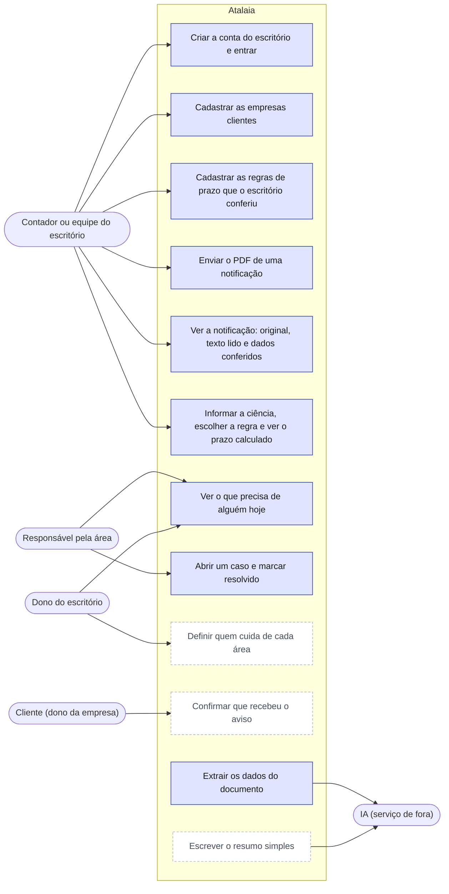
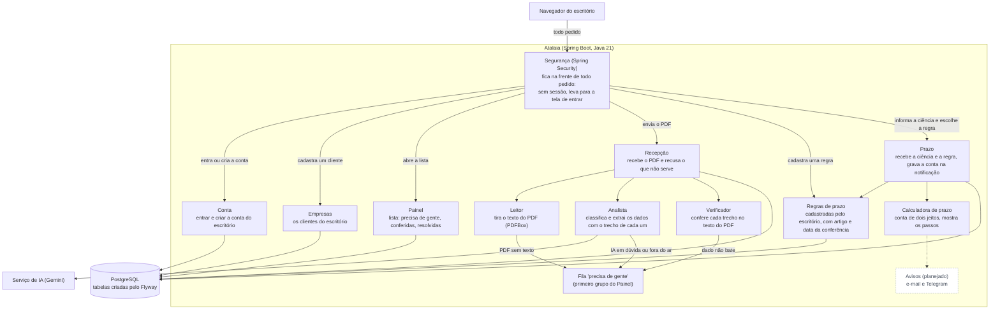
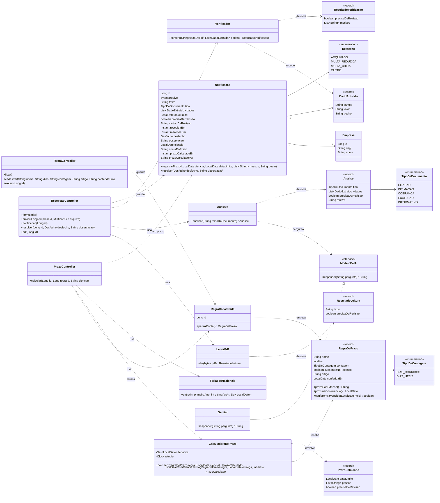
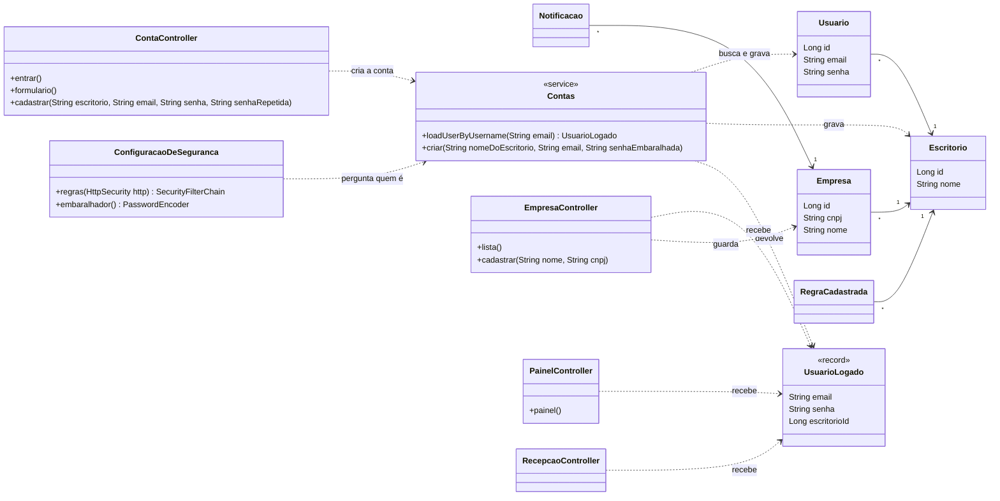
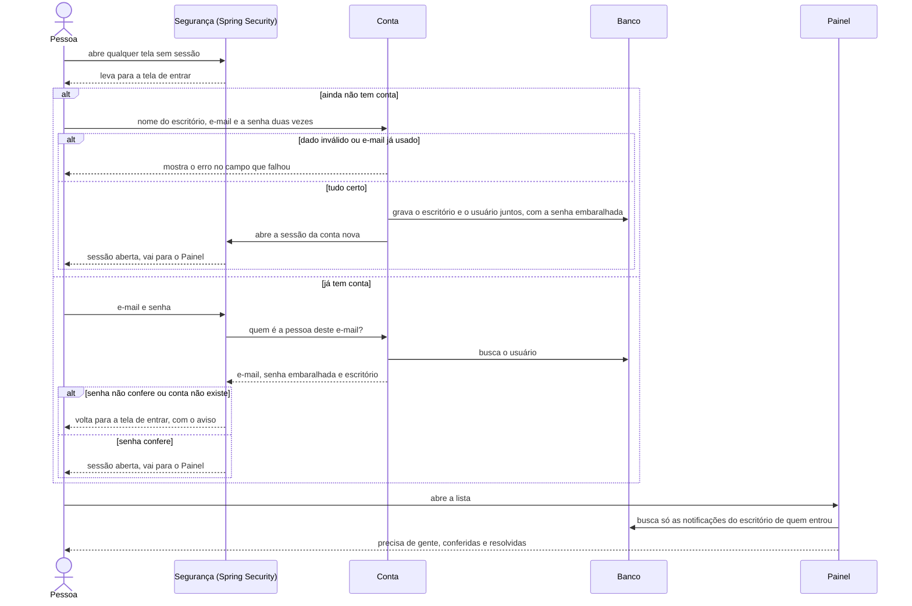
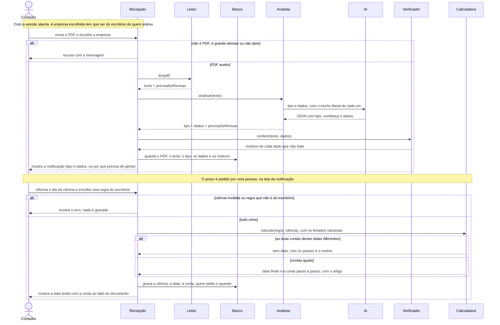
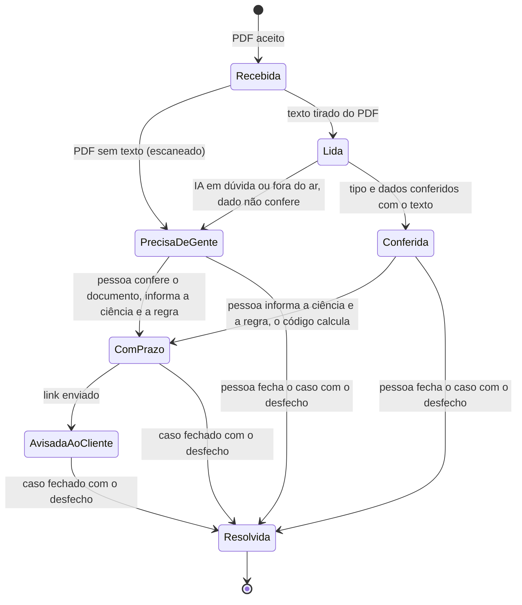
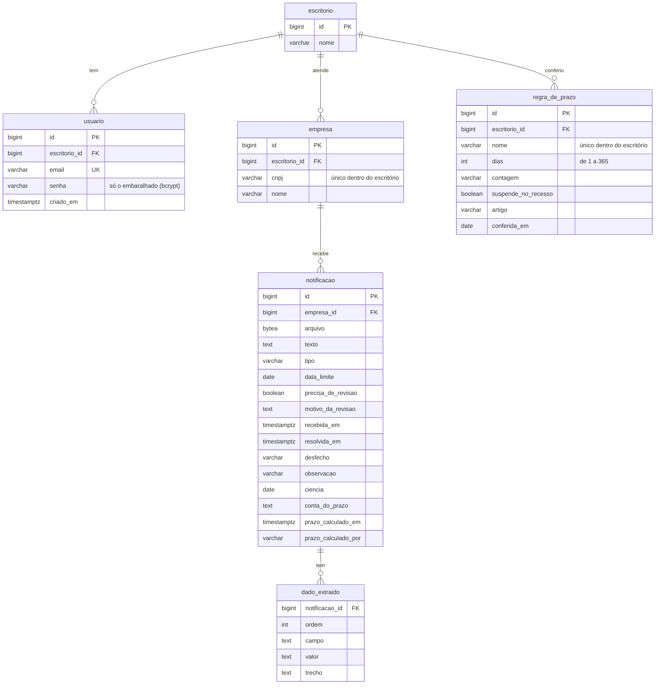

# Arquitetura e diagramas · Atalaia (Marco 2, 18/11/2026, já com o login e o prazo na tela)

Como o Atalaia é montado por dentro e como as peças conversam. Os desenhos são feitos em Mermaid, que o GitHub desenha sozinho.

Em cada diagrama separei o que **já existe no código** do que está **planejado**. Planejado aparece tracejado ou com a marca "(planejado)".

## A ideia em uma frase

O PDF passa por uma fila de peças pequenas. Cada peça faz uma coisa só e sabe dizer "precisa de gente". A IA participa de duas peças e nunca calcula prazo.

## 1. Casos de uso

Quem usa o Atalaia e para quê. A IA aparece como ator, porque é um serviço de fora que o sistema chama.

Azul: já dá para fazer. Tracejado: planejado.

Hoje toda pessoa que entra pode o mesmo, dentro do próprio escritório. Os papéis (responsável pela área, dono) entram junto com "definir quem cuida de cada área".

## 2. Arquitetura: as peças e quem chama quem

Um sistema só (monólito) em Spring Boot. As telas são páginas HTML montadas no servidor (Thymeleaf), sem aplicativo separado.

Seta cheia: ligação que já funciona. Seta tracejada: a peça existe (ou está planejada), mas a ligação ainda não foi feita.

Decisões:

- **A IA nunca calcula prazo.** O prazo sai da Calculadora, que é só `java.time`.
- **Nenhuma regra de prazo vem no código.** Cada escritório cadastra as regras que ele mesmo leu na norma, com o artigo e a data da conferência (RNF09). Seis meses depois, a regra aparece como vencida, pedindo nova conferência.
- **O prazo nasce de uma pessoa.** Ela informa o dia da ciência e escolhe a regra; a Calculadora faz a conta de dois jeitos e a notificação guarda a data com a conta inteira, o artigo, quem pediu e quando. A conta é uma cópia: excluir a regra depois não muda o que foi mostrado. Se as duas contas não baterem, a notificação fica sem data e mostra o motivo.
- **Feriados: só os nacionais de data fixa.** Toda conta avisa que feriado estadual, municipal, ponto facultativo e Sexta-feira Santa não entram, para a pessoa conferir.
- **Toda peça devolve um aviso `precisaDeRevisao`.** É o mesmo desenho no Leitor, no Verificador e na Calculadora. Se uma falhar, o caso fica sem prazo e vai para uma pessoa (RNF01).
- **O escritório é a cerca dos dados.** Cada usuário e cada empresa pertencem a um escritório. Toda busca de empresa ou de notificação leva o `escritorioId` de quem entrou, e a notificação de outro escritório responde como se não existisse (404). O `IsolamentoEntreEscritoriosTest` tenta furar essa cerca de quatro jeitos.
- **A pessoa se cadastra sozinha.** O cadastro grava o escritório e a primeira pessoa dele juntos (ou os dois, ou nenhum) e a conta já nasce com a sessão aberta. Ainda não há papéis nem convite de colegas.
- **A senha nunca é guardada.** Só o embaralhado dela (bcrypt). Quem confere e-mail e senha é o Spring Security; a sessão anda só pelo cookie, todo formulário leva o código contra pedido forjado (CSRF) e sair é por POST.
- **Toda resposta sai com cabeçalhos de segurança** (filtro `CabecalhosDeSeguranca`): a página só carrega o que é do próprio Atalaia e não pode ser mostrada dentro de outro site.
- **O banco é criado pelo Flyway**, por arquivos SQL numerados. O Hibernate só confere se as classes batem com as tabelas.
- **A Recepção rege o caminho.** Ela chama o Leitor, o Analista e o Verificador, um depois do outro, e junta os motivos de revisão. Com um motivo que seja, a notificação vai para uma pessoa.
- **A IA fica atrás de uma interface** (`ModeloDeIA`). Hoje quem responde é o Gemini; os testes usam uma IA de mentira, sem internet. Sem a chave `GEMINI_API_KEY`, o sistema sobe igual e manda tudo para revisão.
- **O que a IA diz é conferido por código.** Cada dado precisa aparecer no texto do PDF (Verificador), e um "informativo" que fala em prazo, intimação, citação ou multa vai para revisão.
- **Peças conversando por eventos** (uma publica "documento lido", a outra escuta): fica para quando a análise sair do pedido da tela. Hoje a pessoa espera a resposta da IA com a tela aberta.

## 3. Classes

O que está no código hoje (o `PainelController` e os controllers da conta estão no 3.2). Os pacotes são `leitor`, `analista`, `verificador`, `prazo`, `notificacao`, `recepcao`, `painel`, `conta` e `seguranca`: cada peça mora no pacote com o nome dela.

São dois desenhos, para caber na tela: primeiro o caminho do PDF, depois a conta e a cerca do escritório.

### 3.1 O caminho do PDF

### 3.2 A conta e a cerca do escritório

`Usuario.senha` guarda só o embaralhado (bcrypt). O `UsuarioLogado` é o que o Spring Security mantém enquanto a sessão está aberta: os três controllers recebem esse objeto e usam o `escritorioId` dele em toda busca. A notificação não tem escritório próprio: chega nele pela empresa.

Quando o arquivo passa da trava do servidor (15 MB), o pedido é barrado antes do controller e a pessoa vê a página de erro (`error.html`) com a mensagem do limite.

## 4. Sequências

### 4.1 Criar a conta e entrar

Escritório novo ainda não tem empresa: o Painel aponta para a tela Empresas, que é o primeiro passo antes de enviar um PDF.

### 4.2 Do PDF enviado até o prazo

No desenho, "Recepção" é a tela da notificação: o pedido do prazo é atendido pelo `PrazoController`.

## 5. Estados da notificação

Hoje o código chega a **Conferida** ou **Precisa de gente** (pelo aviso `precisaDeRevisao`), das duas a **Com prazo**, e de qualquer uma a **Resolvida**. **Avisada ao cliente** é o plano do Marco 3.

O estado não é uma coluna do banco: sai dos campos da notificação (`precisaDeRevisao`, `dataLimite`, `resolvidaEm`).

## 6. O banco

| Arquivo | O que faz |
|---|---|
| `V1__empresa_e_notificacao.sql` | Cria `empresa` (CNPJ único, 14 posições) e `notificacao` (texto lido, data limite, aviso de revisão, quando chegou) |
| `V2__notificacao_guarda_o_pdf.sql` | A notificação passa a guardar o PDF original |
| `V3__notificacao_guarda_a_analise.sql` | A notificação passa a guardar o tipo e os motivos da revisão; cria `dado_extraido` (campo, valor, trecho e a ordem de cada dado) |
| `V4__notificacao_resolvida.sql` | A notificação pode ser resolvida: quando, o desfecho e a observação (os três vazios ou os três preenchidos) |
| `V5__desfecho_so_aceita_os_quatro.sql` | O banco só aceita os quatro desfechos que existem no Java |
| `V6__escritorio_e_usuario.sql` | Cria `escritorio` e `usuario` (e-mail único, senha embaralhada); cada empresa passa a ser de um escritório, e o CNPJ deixa de ser único no sistema inteiro para ser único dentro do escritório |
| `V7__regra_de_prazo.sql` | Cria `regra_de_prazo`: as regras que cada escritório conferiu na norma, com artigo e data da conferência |
| `V8__notificacao_guarda_a_conta_do_prazo.sql` | A notificação passa a guardar a ciência, a conta passo a passo, quem pediu e quando (os quatro vazios ou os quatro preenchidos) |
| `db/exemplo/R__empresas_de_exemplo.sql` | Ficou vazio: com o login, cada escritório cadastra as próprias empresas. O arquivo continua porque o Flyway já registrou o nome dele |

Arquivo que entrou na `main` não se edita: mudou, cria o próximo número.

## 7. Como a qualidade é conferida

- Cada peça tem os próprios testes JUnit; o `./mvnw verify` roda todos antes de qualquer PR.
- Toda mudança entra por PR com `Resolve #N`, e passa por uma revisão antes do merge.
- Os testes usam o H2 em memória com as mesmas migrações do Flyway.
- O isolamento entre escritórios tem teste próprio: dois escritórios, e um tenta ver, resolver, listar e enviar no lugar do outro.
- O login passou por teste de invasão antes de entrar na `main`, sem achado crítico ou alto. O que ficou para antes de ir ao ar está na issue #144.
- Só dado inventado: regra de prazo de exemplo, empresas de exemplo, PDFs de exemplo.
