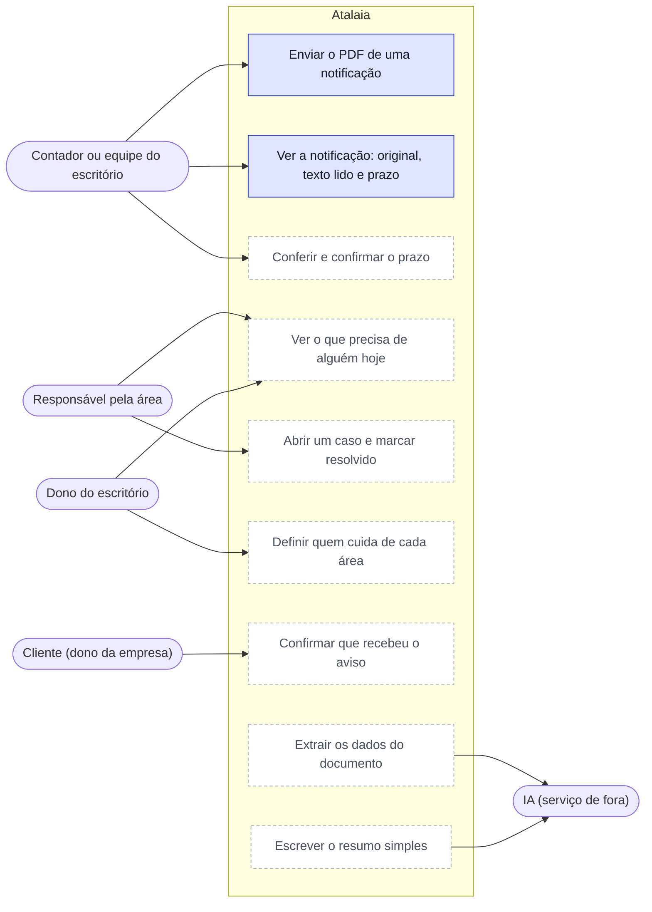
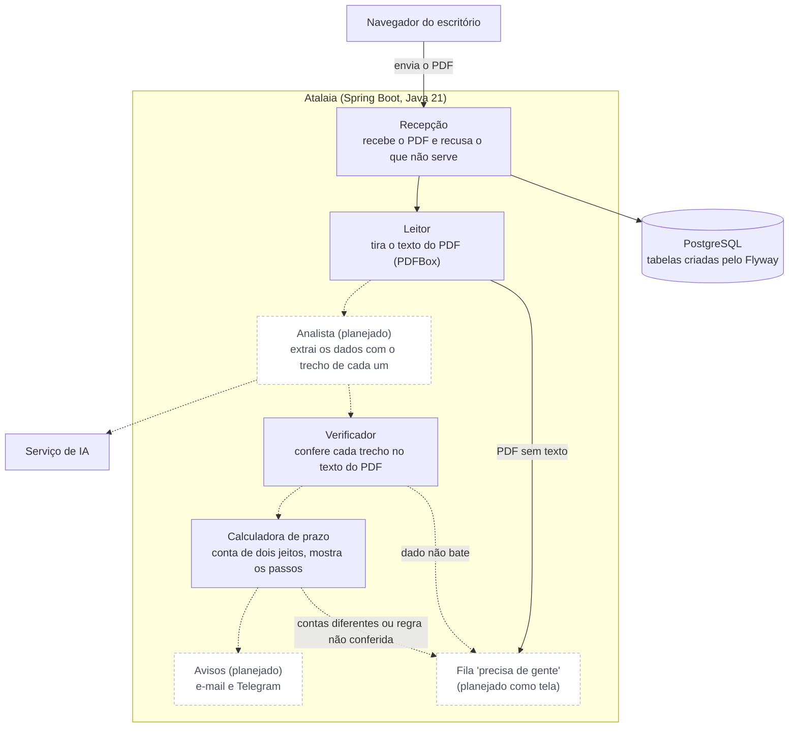
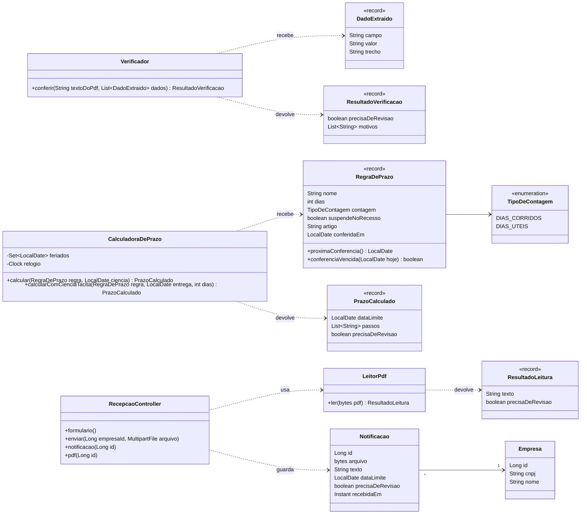
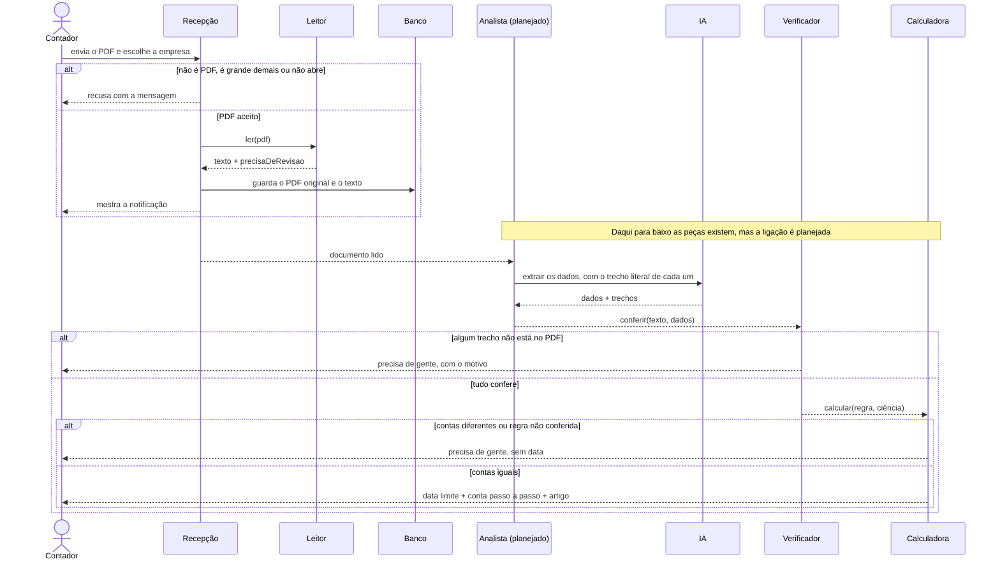
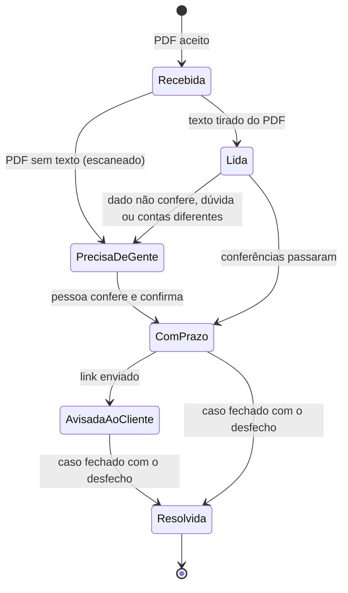

# Arquitetura e diagramas · Atalaia (Marco 2, 18/11/2026)

Como o Atalaia é montado por dentro e como as peças conversam. Os desenhos são feitos em Mermaid, que o GitHub desenha sozinho.

Em cada diagrama separei o que **já existe no código** do que está **planejado**. Planejado aparece tracejado ou com a marca "(planejado)".

## A ideia em uma frase

O PDF passa por uma fila de peças pequenas. Cada peça faz uma coisa só e sabe dizer "precisa de gente". A IA participa de duas peças e nunca calcula prazo.

## 1. Casos de uso

Quem usa o Atalaia e para quê. A IA aparece como ator, porque é um serviço de fora que o sistema chama.

Azul: já dá para fazer. Tracejado: planejado.

## 2. Arquitetura: as peças e quem chama quem

Um sistema só (monólito) em Spring Boot. As telas são páginas HTML montadas no servidor (Thymeleaf), sem aplicativo separado.

Seta cheia: ligação que já funciona. Seta tracejada: a peça existe (ou está planejada), mas a ligação ainda não foi feita.

Decisões:

- **A IA nunca calcula prazo.** O prazo sai da Calculadora, que é só `java.time`.
- **Toda peça devolve um aviso `precisaDeRevisao`.** É o mesmo desenho no Leitor, no Verificador e na Calculadora. Se uma falhar, o caso fica sem prazo e vai para uma pessoa (RNF01).
- **O banco é criado pelo Flyway**, por arquivos SQL numerados. O Hibernate só confere se as classes batem com as tabelas.
- **Peças conversando por eventos** (uma publica "documento lido", a outra escuta): é o plano para quando o Analista entrar. Hoje as ligações que existem são chamadas diretas, porque só há duas.

## 3. Classes

O que está no código hoje. Os pacotes são `leitor`, `verificador`, `prazo`, `notificacao` e `recepcao`: cada peça mora no pacote com o nome dela.

Os pacotes `notificacao` e `recepcao` chegam com a tela de envio (US07, PR #141).

## 4. Sequência: do PDF enviado até o prazo

## 5. Estados da notificação

Hoje o código chega até **Lida** ou **Precisa de gente** (pelo aviso `precisaDeRevisao`). Os outros estados são o plano dos Marcos 3 e 4.

## 6. O banco

| Arquivo | O que faz |
|---|---|
| `V1__empresa_e_notificacao.sql` | Cria `empresa` (CNPJ único, 14 posições) e `notificacao` (texto lido, data limite, aviso de revisão, quando chegou) |
| `V2__notificacao_guarda_o_pdf.sql` | A notificação passa a guardar o PDF original (PR #141) |
| `db/exemplo/R__empresas_de_exemplo.sql` | Empresas inventadas para a prévia (PR #141) |

Arquivo que entrou na `main` não se edita: mudou, cria o próximo número.

## 7. Como a qualidade é conferida

- Cada peça tem os próprios testes JUnit; o `./mvnw verify` roda todos antes de qualquer PR.
- Toda mudança entra por PR com `Resolve #N`, e passa por uma revisão antes do merge.
- Os testes usam o H2 em memória com as mesmas migrações do Flyway.
- Só dado inventado: regra de prazo de exemplo, empresas de exemplo, PDFs de exemplo.
